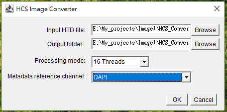

# HCS-Image-Converter
**HCS-Image-Converter** is an ImageJ tool designed for converting CellWorx HTD-based high-content screen(HCS) image data int OME-Tiff flie.
## Features
- Checks whether the TIFF pixel type is supported before conversion.
- Reads TIFF metadata directly to recover information that may be missing from the Bio-Formats import, including stage labels and spatial calibration.
- Supports parallel image conversion with a user-selectable number of worker threads.
## Limitations 
1. Support single-plate HTD files only.
2. If Z- spacing is missing, this tool estimated  from Z-position difference based using the selected reference channel.This estimate may not be accurate. 
## Usage
1. Open **Fiji** and lunch the Scirpt Editor.
2. Open the converter Groovy Script and run it.
3. Select the input HTD file and output folder(Fig 1).
4. choose the processing mode and the metadata reference channel(Fig 1).
   
    
    *Figure 1. HCS Image Converter dialog.*  
5. Wait for the conversion to finish. The converter creates a folder named `<HTD folder name>_convert` inside the selected output folder and saves one OME-TIFF file per image series.
> **Note:** Keep the HTD file and its associated TIFF files in their original directory structure during conversion.

## Comparison of HCS Image Conversion Results

* **Left (Direct conversion with Bio-Formats):**
  * Incorrectly decoded pixel data
  * Renumbered site identifiers (e.g., Field #2)
  * Missing channel colors
  * Lost scale calibration

* **Right (Conversion with HCS Image Converter):**
  * Expected pixel data
  * Correct site numbering (e.g., A01_Site11)
  * Preserved channel colors
  * Accurate scale information
